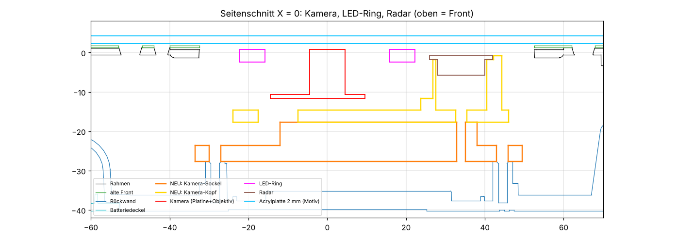

# Etappe 1 – Ergebnis: Bauteile, Einkaufsliste & Einbau

> Stand: 24.11.2026 · Plattform: **Raspberry Pi Zero 2 WH + Camera Module 3 Wide**
> (deine Entscheidung: Bildqualität und Livestream gehen vor Akkulaufzeit).
> Alles, was mit **ANNAHME** markiert ist, prüfst du mit dem **Testteil**, bevor du die
> großen Teile druckst.

---

## 1. Bauraum (Kurzfassung)

Die Details stehen in `cad/analyse/ANALYSE.md`.

- Rahmen: 250,7 × 250,7 mm, ca. 49 mm tief. Innen sind ca. **220 × 220 × 27 mm** frei.
- **Kamera:** Sie sitzt genau in der Bildmitte, hinter der großen Öffnung, wo früher der Lautsprecher war.
- **Raspberry Pi:** Er sitzt rechts unten auf den 4 Schraubpunkten der alten Platine.
- **Strom:** Das Kabel geht durch den seitlichen Schlitz rechts, wo früher das Lautstärke-Rad war.
- **Keine neuen Löcher im Gehäuse.** Benutzt werden nur vorhandene Schraubpunkte und Original-Schrauben.
  - Einzige Änderung: Vom Schlitz bis zur Gehäusekante wird eine **kleine Kerbe** geschnitten, damit das Kabel hineinpasst (siehe Schritt 7).



## 2. Variantenvergleich & Entscheidung

| Kriterium | **Pi Zero 2 W + Camera Module 3 Wide** ✅ | ESP32-S3 (XIAO Sense) |
|---|---|---|
| Montage | nur stecken (Pi mit vorgelöteter Stiftleiste) | evtl. Lötstellen |
| Bildqualität | 12 MP, 120°, Autofokus, gut bei wenig Licht | 2 MP, ca. 66°, schwach bei wenig Licht |
| Livestream | flüssig in HD (H.264) | ruckelig, niedrige Auflösung |
| MCP-Server | **läuft direkt auf dem Rahmen** | braucht extra PC/Server |
| Strom | ca. 1–2,5 W → Dauerstrom über USB | Akku über Wochen möglich |
| Kosten Kernteile | ca. 100 € | ca. 45 € |
| Spätere Serie | eher teuer; Etappe 4 prüft ESP32 oder Compute Module | günstig |

**Empfehlung umgesetzt:** Pi Zero 2 W. Der **Bewegungssensor ist ein Radar** (HLK-LD2410C).
Er sieht **durch Acryl und Kunststoff hindurch**, braucht also **kein Loch**, und er erkennt
auch Personen, die still sitzen.

## 3. Einkaufsliste – Phase 1 (USB-Strom)

Die Preise sind grobe Schätzungen (Stand Nov. 2026, nicht tagesaktuell geprüft).
**Suchbegriffe** funktionieren in jedem Shop.

| Nr. | Bauteil | Suchbegriff / Teilenummer | Menge | ca. € | Shops (DE) | Wofür? |
|---|---|---|---|---|---|---|
| 1 | Raspberry Pi Zero 2 **WH** (mit vorgelöteter Stiftleiste!) | „Raspberry Pi Zero 2 WH“ | 1 | 20–25 | Berrybase, Reichelt, Eckstein, Welectron | der kleine Computer: Kamera, Stream, MCP-Server |
| 2 | Raspberry Pi **Camera Module 3 Wide** (nicht NoIR) | „Camera Module 3 Wide“ | 1 | 35–40 | Berrybase, Reichelt, Eckstein, Elektor | die Kamera (120°, 25 × 24 × 12,4 mm) |
| 3 | Kamerakabel **Standard auf Mini, 200 mm** (für Pi Zero) | „Raspberry Pi Zero Kamerakabel 200 mm“ | 1 | 3–5 | wie oben | Kamera → Pi (die mitgelieferte Kamera-Leitung passt **nicht** an den Pi Zero) |
| 4 | Offizielles Raspberry-Pi-Netzteil **Micro-USB 5,1 V / 2,5 A**, 1,5 m | „Raspberry Pi Netzteil micro USB 2,5A“ | 1 | 8–10 | wie oben | Strom |
| 5 | microSD **32 GB „High Endurance“** | „SanDisk High Endurance 32GB“ | 1 | 10–12 | Amazon, MediaMarkt, Berrybase | Betriebssystem + Aufnahmen (für Dauerbetrieb gemacht) |
| 6 | **HLK-LD2410C** Radarsensor **mit Stiftleiste** („pre-soldered“) | „LD2410C Stiftleiste“ | 1 | 5–10 | Amazon, eBay, Berrybase, Pi Hut | Bewegung/Anwesenheit erkennen, durch das Bild hindurch |
| 7 | **LED-Ring 16 × WS2812B, Ø 44,5 mm** | „WS2812B 16 LED Ring“ / „NeoPixel Ring 16“ | 1 | 5–12 | Berrybase, Eckstein, AZ-Delivery | leuchtender Ring um die Pupille = Aufnahme-Anzeige |
| 8 | Jumper-Kabel **Buchse–Buchse, 30 cm** (40er-Pack) | „Jumper Kabel female female 30cm“ | 1 | 4–6 | überall | Radar + LED-Ring → Pi (stecken) |
| 9 | Kühlkörper für Pi Zero (selbstklebend) | „Kühlkörper Raspberry Pi Zero“ | 1 | 2–4 | Berrybase, Amazon | der Rahmen ist geschlossen, der Pi wird warm |
| 10 | Schrauben **M2 × 6** und **M2,5 × 8** (Zylinderkopf, Edelstahl), am einfachsten als Sortiment | „Schrauben Sortiment M2 M2,5“ | je 4 + 3 | 8–10 | Amazon, Baumarkt | Kamera (M2), Pi + Kamera-Kopf (M2,5); sie schneiden ihr Gewinde selbst in den Druck |
| 11 | **Moosgummi schwarz, selbstklebend, 2 mm** (A4) | „Moosgummi selbstklebend schwarz 2mm“ | 1 | 3–5 | Bastelladen, Amazon | Dichtring um das Objektiv (gegen Spiegelungen) |
| 12 | Locheisen-Set 3–12 mm | „Locheisen Set“ | 1 | 8–10 | Baumarkt | Dichtring sauber ausstanzen (alternativ Schere) |
| 13 | Kleine Kabelbinder (2,5 mm breit) | – | 10 | 2–3 | Baumarkt | Kabel ordentlich befestigen |
| 14 | Filament **PETG schwarz** (falls nicht vorhanden) | – | ca. 40 g | – | Bambu Store | Druckteile (schwarz = kein Streulicht) |
| 15 | Acrylplatte 2 mm, UV-Druck | über eure Druckerei | 1 | – | eure UV-Druckerei | das Motiv (Vorlage siehe Abschnitt 5b) |

**Summe Phase 1:** Kernteile 1–7 ca. **90–115 €**, mit Kleinteilen und Werkzeug ca. **120–150 €**.

### Werkzeug

| Werkzeug | Status |
|---|---|
| Kreuzschlitz-Schraubendreher PH0 + PH1 | vorhanden |
| Cuttermesser und kleine Feile (für die Kabel-Kerbe) | ca. 10 €, falls nicht da |
| microSD-Kartenleser für den PC | ca. 8 €, falls dein PC keinen hat |
| **Lötkolben** | **nur für den LED-Ring: 3 Lötstellen** (siehe unten) |

**Löten: nur 3 Lötstellen, und es gibt eine lötfreie Alternative.**
- **Mit Löten:** Der WS2812B-Ring (Nr. 7) hat Lötpunkte statt Steckern. Du lötest 3 Jumper-Kabel an: 5V, GND und DIN.
  - Einsteiger-Lötstation (z. B. „Lötstation 60 W mit Temperaturregelung“, ca. 25–35 €)
  - bleifreies Lötzinn 0,8 mm
  - kurze Anleitung in Schritt 4b
- **Ohne Löten:** **Seeed Grove RGB LED Ring 16 × WS2813 Mini** (104020171), mit Stecker.
  - Dazu brauchst du ein „Grove auf Buchse“-Adapterkabel.
  - Er ist aber **Ø 58 mm** groß und laut Händlern teils ausverkauft bzw. ausgelaufen.
  - Wenn du ihn nimmst, trägst du in `fanbox_teile.py` den Durchmesser ein und erzeugst die Teile neu (siehe Abschnitt 5).

### Phase 2 (Akku) – nicht jetzt kaufen

Ehrlich gesagt: Mit dem Pi ist **Akkubetrieb nur kurzzeitig sinnvoll**, nämlich ca. **1 Tag pro 10.000 mAh** (Rechnung siehe Abschnitt 6).
- **Vorübergehend** reicht eine Powerbank mit Pass-Through, die sich unauffällig hinter dem Rahmen platzieren lässt. Ein Umbau ist nicht nötig, du steckst nur das Kabel um.
- **Echter Akku über Wochen** geht nur mit der ESP32-Variante. Das klären wir in Etappe 4.

## 4. Verbindungsplan (nur Stecken, außer LED-Ring)

```
                         ┌───────────────── Raspberry Pi Zero 2 WH ─────────────────┐
  Kamera 3 Wide ──Flachband 200 mm──► [CAM-Buchse]                                  │
                                       │  Stiftleiste (40 Pins)                        │
  Radar LD2410C  VCC ──────────────────► Pin 4  (5V)                                  │
                 GND ──────────────────► Pin 9  (GND)                                 │
                 OUT ──────────────────► Pin 11 (GPIO17)  Bewegung ja/nein            │
                 Tx  ──────────────────► Pin 10 (GPIO15 / RXD)  Einstellungen/Distanz │
                 Rx  ──────────────────► Pin 8  (GPIO14 / TXD)                        │
  LED-Ring       5V  ──────────────────► Pin 2  (5V)                                  │
                 GND ──────────────────► Pin 6  (GND)                                 │
                 DIN ──────────────────► Pin 19 (GPIO10 / SPI MOSI)                   │
  Netzteil Micro-USB ─────────────────► Buchse „PWR IN“ (die äußere, nahe Kamera-Buchse)
                         └──────────────────────────────────────────────────────────┘
```

**Pin-Nummern auf dem Pi:** Pin 1 ist die Ecke mit dem **quadratischen Lötauge** auf der Unterseite, nahe dem SD-Kartenschlitz.
- Ungerade Pins (1, 3, 5 …) liegen in der Reihe zur **Platinenmitte**.
- Gerade Pins (2, 4, 6 …) liegen in der Reihe zum **Rand**.

| Kabel | von | nach (Pi-Pin) | Farbe (Vorschlag) | Achtung |
|---|---|---|---|---|
| K1 | Kamera | CAM-Buchse am Pi | Flachband | **Kontakte zeigen zur Platine.** Schwarzen Riegel erst vorsichtig herausziehen, dann Kabel einschieben und Riegel zudrücken. Beide Enden! |
| K2 | Radar **VCC** | Pin 4 (5V) | rot | Beschriftung auf dem Radar lesen. Laut Datenblatt ist die Reihenfolge Tx, Rx, OUT, GND, VCC. |
| K3 | Radar **GND** | Pin 9 (GND) | schwarz | |
| K4 | Radar **OUT** | Pin 11 (GPIO17) | gelb | |
| K5 | Radar **Tx** | Pin 10 (RXD) | grün | Tx immer an Rx, über Kreuz |
| K6 | Radar **Rx** | Pin 8 (TXD) | blau | |
| K7 | LED-Ring **5V / VCC** | Pin 2 (5V) | rot | |
| K8 | LED-Ring **GND** | Pin 6 (GND) | schwarz | |
| K9 | LED-Ring **DIN** (Data **In**, nicht DOUT!) | Pin 19 (GPIO10) | weiß | |
| K10 | Netzteil | Micro-USB „PWR IN“ | – | Die **andere** Micro-USB-Buchse liefert keinen Strom an den Pi. |

**Typische Fehler und wie du sie vermeidest:**
1. **Flachband verkehrt herum:** Dann bleibt das Bild schwarz, kaputt geht aber nichts. Einfach umdrehen.
2. **5V auf einen falschen Pin:** Das kann den Pi zerstören. Vor dem Einschalten jede Ader mit der Tabelle vergleichen.
3. **LED-Ring an DOUT statt DIN:** Dann bleibt der Ring dunkel. Umstecken bzw. umlöten.
4. **Schwaches Handy-Netzteil:** Das führt zu zufälligen Abstürzen. Das offizielle Netzteil verwenden.

### 4b. LED-Ring anlöten (3 Lötstellen, nur bei Ring Nr. 7)

1. Von 3 Jumper-Kabeln (Buchse–Buchse) jeweils **eine** Buchse abschneiden und 3 mm abisolieren.
2. Die Lötstation auf ca. 330 °C stellen, die Spitze verzinnen.
3. Die Lötpunkte **5V**, **GND** und **DIN** auf dem Ring kurz mit Zinn benetzen.
4. Das Kabel auflegen, mit der Spitze 2 Sekunden erwärmen, bis das Zinn fließt, dann ruhig halten.
5. Zur Kontrolle leicht am Kabel ziehen: Es muss fest sitzen, und die Lötstelle muss glänzen.

## 5. Druckteile (3D-Druck)

Alle Dateien liegen in `cad/halterungen/`. Die Maße sind parametrisch im Quellcode `cad/halterungen/src/fanbox_teile.py`.

| Teil | Datei | Größe | Funktion |
|---|---|---|---|
| **Testteil** | `testteil.stl` | 80 × 41 × 6 mm | **zuerst drucken!** Prüft Lochbilder von Kamera, Pi und Radar sowie die Schraubenlöcher |
| Kamera-Sockel | `kamera_sockel.stl` | 20 × 83 × 10 mm | wird mit den **2 Original-Schrauben** des alten Lautsprechers auf die Rückwand geschraubt |
| Kamera-Kopf | `kamera_kopf.stl` | 54 × 70 × 17 mm | trägt Kamera, LED-Ring und Radar; 3 Schrauben M2,5 × 8 in den Sockel |
| Pi-Platte | `pi_platte.stl` | 40 × 70 × 6 mm | Pi Zero; 2 **Original-Schrauben** der alten Platine, 2 Passstifte |
| Zentrier-Schablone | `zentrier_schablone.stl` | 226 × 226 × 0,8 mm | markiert die Bildmitte (Loch im Stoff bzw. in der Front) und die Position der Acrylplatte |

**Bambu Studio:**
- `druckplatte_1_halterungen.3mf` enthält alle Halter, schon angeordnet.
- `druckplatte_2_schablone.3mf` enthält die Schablone.

Nach dem Öffnen: Rechtsklick auf das Objekt → **„In Objekte aufteilen“**. Dann das Druckprofil wählen und slicen.

### Druckeinstellungen (Bambu Lab X1 Carbon, 0,4-mm-Düse)

| Teil | Material | Schicht | Wände | Infill | Ausrichtung | Stützen | Zeit ca. |
|---|---|---|---|---|---|---|---|
| Testteil | PLA oder PETG | 0,2 mm | 3 | 20 % | wie exportiert | **nein** | 15 min |
| Kamera-Sockel | **PETG** | 0,2 mm | 4 | 30 % Gyroid | wie exportiert (Brücke unten) | **nein** | 30 min |
| Kamera-Kopf | **PETG schwarz** | 0,2 mm | 4 | 30 % Gyroid | wie exportiert (Platte unten) | **nein** | 1 h |
| Pi-Platte | **PETG** | 0,2 mm | 4 | 30 % | wie exportiert | **nein** | 35 min |
| Schablone | PLA | 0,2 mm | 2 | 100 % | flach | nein | 45 min |

**Warum PETG?** Kamera und Pi werden im geschlossenen Rahmen warm, und PLA wird ab ca. 55 °C weich.
**Warum schwarz?** Damit kein Licht im Inneren reflektiert und das Kamerabild nicht grau wird.

### Reihenfolge

1. Testteil drucken.
2. Passung prüfen (siehe 7.1).
3. Falls nötig, `FIT`, `CAM_PILOT` oder `PI_PILOT` in `fanbox_teile.py` ändern und den Rest neu erzeugen:
   ```
   pip install cadquery
   python cad/halterungen/src/fanbox_teile.py
   ```
4. Den Rest drucken.

### Kollisionsprüfung

`cad/tools/kollision.py` prüft alle Teile **und Platzhalter für die Elektronik** gegen das echte Gehäuse aus deiner STEP-Datei.

Ergebnis: **„OK – keine Kollisionen“**. Die Vorschaubilder liegen in `cad/halterungen/vorschau/`.

## 5b. Kamera-Auge & Acrylplatte

- **Kamera:** Das Objektiv sitzt **exakt in der Bildmitte** und endet **1,5 mm hinter der Acrylplatte**. Diesen Spalt schließt ein **Moosgummi-Ring**, der außen ca. 12 mm und innen ca. 6 mm misst. Er verhindert Spiegelungen und Streulicht.
- **LED-Ring:** Er liegt konzentrisch um das Objektiv, ca. 1,5 mm hinter der Platte.
- **Radar:** Es sitzt über dem LED-Ring (Mitte 34 mm über der Bildmitte), unsichtbar hinter dem Motiv.

### Druckvorlage

Die Dateien liegen in `cad/druckvorlage/`.

| Datei | Wofür |
|---|---|
| `fanbox_motivplatte_vorlage.svg` | Ebenen für Inkscape/Affinity/Illustrator: **MOTIV**, **WEISS** (Spot-Farbe), **ZONEN** und **HILFSLINIEN** (die letzten beiden nicht drucken) |
| `fanbox_motivplatte_vorlage.pdf` | Übersicht im Maßstab 1:1. Mit der 100-mm-Kontrolllinie prüfst du die Druckgröße. |
| `fanbox_weissmaske.svg` | nur die Weiß-Ebene, falls die Druckerei sie separat möchte |

| Maß | Wert |
|---|---|
| Endformat | **226,4 × 226,4 mm**, plus 3 mm Beschnitt pro Seite (ggf. mit der Druckerei abstimmen) |
| **Kamera-Fenster** | **Ø 12 mm völlig unbedruckt**, genau in der Mitte |
| **LED-Zone** | Ring Ø 30–47 mm: **Farbe ohne Weiß-Unterdruck**, damit das Licht durchscheint |
| Empfehlung für das Iris-Motiv | Pupille **Ø 64 mm**, Iris **Ø 200 mm**. Das Kamera-Fenster und die LED-Zone liegen dann in der schwarzen Pupille, und die Pupille glüht, wenn aufgenommen wird. |
| Radar-Bereich | keine Metallic- oder Spiegelfarben |
| Klebeband | **nur im 12-mm-Randstreifen.** Dort liegt die alte Front darunter; in der Mitte ist sie offen. |

**Fragen an die UV-Druckerei:**
- Druckt ihr **hinterseitig** (Druck auf der Rückseite, kratzfest)?
- Wie wollt ihr die Weiß-Ebene geliefert bekommen?
- Haltet ihr das Kamera-Fenster wirklich farbfrei?

## 6. Energiebilanz

| Zustand | Leistung (ca.) | Bemerkung |
|---|---|---|
| Pi Zero 2 W im Leerlauf, WLAN an | 0,6–0,8 W | |
| + Radar LD2410C | + 0,4 W | läuft dauernd |
| + Kamera aktiv / Livestream (H.264) | + 0,8–1,2 W | nur bei Bewegung oder auf Abruf |
| + LED-Ring (rot, 30 % Helligkeit) | + 0,2–0,5 W | nur während der Aufnahme |
| **Spitze** | **ca. 2,5–3 W** | das Netzteil (12,5 W) reicht locker |
| **Durchschnitt** | **ca. 1,2–1,5 W** | ≈ 30–36 Wh pro Tag ≈ **ca. 4 € Strom im Jahr** |

**Akku (Phase 2):** Eine 10.000-mAh-Powerbank hat ca. 37 Wh, davon ca. 30 Wh nutzbar. Das ergibt **ca. 20–25 Stunden**.

## 7. Bauanleitung Schritt für Schritt

**7.1 Testteil prüfen**

| Prüfung | So erkennst du, dass es passt |
|---|---|
| Kamera auf die 4 kleinen Säulen legen | Die Löcher fluchten, und M2 × 6 lässt sich mit leichtem Widerstand eindrehen. |
| Pi auf die 2 Säulen legen | Die Löcher fluchten, und M2,5 × 8 lässt sich eindrehen. |
| Radar in die Tasche legen | Es liegt ohne Klemmen und ohne Wackeln. |
| Original-Schrauben in die großen Löcher stecken | Sie gleiten durch. |
| Den Pin einer alten Platinen-Säule durch das Rechteck stecken | Er passt. |

**7.2 Alte Elektronik ausbauen**
1. Die 8 Schrauben auf der Rückseite lösen und die Rückwand abnehmen.
2. Lautsprecher (2 Schrauben), Platine (4 Schrauben), Batteriefach-Platine und Kabel ausbauen.
3. **Alle Schrauben aufheben!** Die 2 Lautsprecher-Schrauben und 2 der Platinen-Schrauben brauchen wir wieder.

**7.3 Kabel-Kerbe** (die einzige Gehäuse-Änderung)
1. Vom vorhandenen seitlichen Schlitz (16 × 4 mm) bis zur Oberkante der Rückwand schneidest du mit Cutter oder kleiner Säge (Puksäge) 2 senkrechte Schnitte im Abstand von **5 mm**. Den Steg dazwischen brichst du heraus und feilst die Kanten glatt.
2. **Prüfen:** Das Netzteil-Kabel lässt sich von oben in die Kerbe legen. Beim Zusammenbau deckt der Rahmen die Kerbe ab.

**7.4 microSD vorbereiten** (am PC; die genaue Anleitung folgt in Etappe 2)
- Mit dem **Raspberry Pi Imager** „Raspberry Pi OS Lite (64-bit)“ aufspielen.
- Im Imager **WLAN, Benutzer und SSH** voreinstellen.
- **Prüfen:** Der Imager meldet „Schreiben erfolgreich“.

**7.5 Pi vorbereiten**
1. Kühlkörper auf den Chip kleben.
2. Pi auf die Pi-Platte setzen, **Anschlüsse zur Batteriefach-Seite** (nach links), und mit 4 × M2,5 × 8 verschrauben.
3. Kamera-Flachband in den Pi stecken.

**7.6 Pi-Platte einbauen**
1. Die Platte auf die 4 alten Platinen-Säulen setzen. Die 2 Passstifte rasten in die Rechtecke ein.
2. Mit **2 Original-Schrauben** an den rechten Säulen festschrauben.
3. **Prüfen:** Die Platte wackelt nicht.

**7.7 Kamera-Sockel einbauen**
1. Den Sockel auf die 2 alten Lautsprecher-Säulen in der Mitte setzen.
2. Mit den **2 Original-Lautsprecher-Schrauben** festschrauben.

**7.8 Kamera-Kopf aufsetzen**
- Den Kopf mit 3 × M2,5 × 8 auf den Sockel schrauben.
- Das muss **vor** der Kamera passieren, denn zwei der Schrauben liegen später unter der Kamera.

**7.9 Kamera-Kopf bestücken**
1. Kamera mit 4 × M2 × 6 verschrauben. Das Flachband zeigt nach unten durch das Fenster.
2. LED-Ring mit 4 kleinen Klebepads auf die 4 Säulchen kleben. Die Kabel zeigen nach unten.
3. Radar in den Rahmen legen, **die Seite mit den Antennen-Flächen nach vorn**. Ein Klebepad hält es.

**7.10 Verkabeln** nach der Tabelle in Abschnitt 4. Die Kabel bündelst du mit Kabelbindern an der Pi-Platte.

**7.11 Dichtring**
1. Aus dem Moosgummi einen Ring ausstanzen: außen 12 mm, innen 6 mm.
2. Den Ring auf die Objektiv-Front kleben. Das Loch muss frei über der Linse liegen.

**7.12 Erster Test bei offenem Rahmen** (Software aus Etappe 2)
- Strom anschließen. Die **grüne LED am Pi** blinkt, nach ca. 1 Minute ist er im WLAN.

**7.13 Front & Motiv**
1. Die Zentrier-Schablone in den Rahmen legen.
2. An der Mitte ein Loch von **Ø 14 mm** in den Stoff bzw. in die alte Front schneiden.
3. Die Acrylplatte mit Klebeband im Randstreifen aufkleben. Die Schablone hilft beim Ausrichten.

**7.14 Rahmen schließen**
1. Die Rückwand aufsetzen. Dabei liegt das Netzteil-Kabel in der Kerbe.
2. Die 8 Schrauben eindrehen.
3. **Prüfen:** Der Moosgummi-Ring berührt die Platte leicht. Durch das Fenster siehst du nur schwarz.

## 8. Rechtliches (Kurzcheck der Konstruktion)

- ✅ **Sichtbare Aufnahme-Anzeige:** Der LED-Ring leuchtet um die Pupille, und die Software kann ihn nicht abschalten (Vorgabe für Etappe 2).
- ✅ Kein Mikrofon, keine Tonaufnahme.
- ⚠️ **Hinweis-Aufkleber** „Kamera / Videoaufnahme“ auf der Rahmen-Unterkante oder an der Tür empfohlen.
- ⚠️ Gäste informieren. Kein Einsatz in Bad oder Schlafzimmer.
- ⚠️ Ob das Augen-Motiv zusammen mit der LED als „erkennbare Kamera“ im Sinne von § 8 TDDDG reicht, kläre vor einer Weitergabe kurz mit der **Bundesnetzagentur**.

## 9. Fertig, wenn …

- [x] Empfohlene Variante steht fest und ist begründet
- [x] Einkaufsliste Phase 1 ist bestellfertig, inkl. Werkzeug; Phase 2 separat
- [x] Verbindungsplan und Bauanleitung sind für Laien geschrieben
- [x] Druckvorlage (SVG/PDF) für die Acrylplatte liegt vor
- [x] STL-, STEP- und 3MF-Dateien liegen vor, inkl. Testteil und Druckeinstellungen; Kollisionsprüfung ohne Befund
- [ ] **Von dir zu prüfen:** Testteil gedruckt und Passung bestätigt (danach ggf. Werte anpassen)

## 10. Zusammenfassung für Etappe 2 (Firmware/Software)

| Thema | Entscheidung |
|---|---|
| Board | Raspberry Pi Zero 2 WH, Raspberry Pi OS Lite 64-bit (Bookworm oder neuer) |
| Kamera | Camera Module 3 **Wide** (IMX708), über libcamera / Picamera2; Bild steht aufrecht, Flachband unten |
| Bewegung | Radar HLK-LD2410C: **OUT → GPIO17** (high = Person erkannt); UART an **GPIO14/15** (`/dev/serial0`, 256000 Baud) für Empfindlichkeit und Distanz; serielle Konsole abschalten, UART einschalten |
| Aufnahme-LED | 16 × WS2812B am **SPI MOSI (GPIO10)**, SPI einschalten; **leuchtet bei jeder Aufnahme und jedem Stream, nicht abschaltbar, nur dimmbar** |
| Strom | 5,1 V / 2,5 A über Micro-USB „PWR IN“; Daueranwendung |
| Ablauf | Radar meldet Bewegung → Foto bzw. Kurzclip → speichern → **Push-Nachricht mit Bild aufs Handy** (z. B. ntfy oder Telegram) → über MCP abrufbar |
| Hinweis | Claude bzw. MCP kann nicht von selbst „anrufen“. Für sofortige Meldungen braucht es eine Push-Nachricht; über Claude fragst du dann nach („Zeig mir das Bild von eben“). |
| Später | MCP-Server läuft **direkt auf dem Pi**; Fernzugriff z. B. per Tailscale (Etappe 3) |

## Quellen der Datenblattwerte

- LED-Ring Grove 16 × WS2813: Ø 58 mm ([The Pi Hut](https://thepihut.com/collections/led-rings/products/grove-rgb-led-ring-16x-ws2813-mini), [Botland](https://botland.com.pl/en/the-chain-and-matrix-led/15555-grove-rgb-led-ring-ws2813-x-16-leds-58-mm-seeedstudio-104020171.html), [Kiwi Electronics](https://www.kiwi-electronics.com/en/grove-rgb-led-ring-16-ws2813-mini-10313))
- HLK-LD2410C: 16 × 22 mm, Pins Tx/Rx/OUT/GND/VCC, 5 V, 3,3-V-Logik ([Hi-Link-Handbuch v1.00](https://www.sudo.is/docs/esphome/components/ld2410/HLK-LD2410C_manual_v1.00.pdf), [Tinkered](https://tinkered.ai/components/ld2410c-mmwave-radar))
- Camera Module 3 Wide: 25 × 24 × 12,4 mm, Lochbild wie Camera Module 2 ([Raspberry Pi Doku](https://www.raspberrypi.com/documentation/hardware/camera/computers/camera_software.html), [Elektor](https://www.elektor.com/raspberry-pi-camera-module-3-wide), [Raspberry Pi Design Files](https://pip.raspberrypi.com/categories/1207-design-files))
